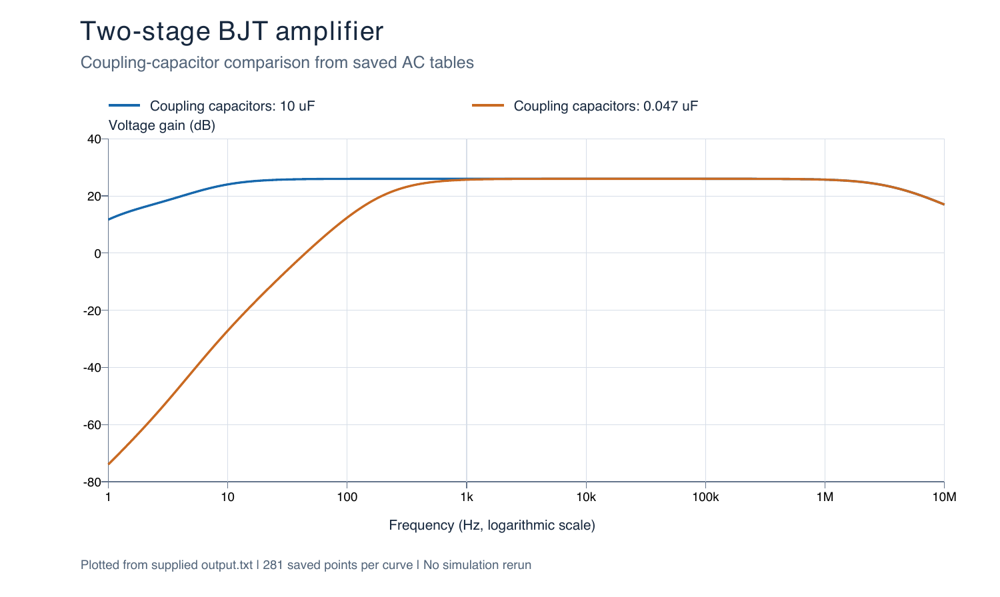
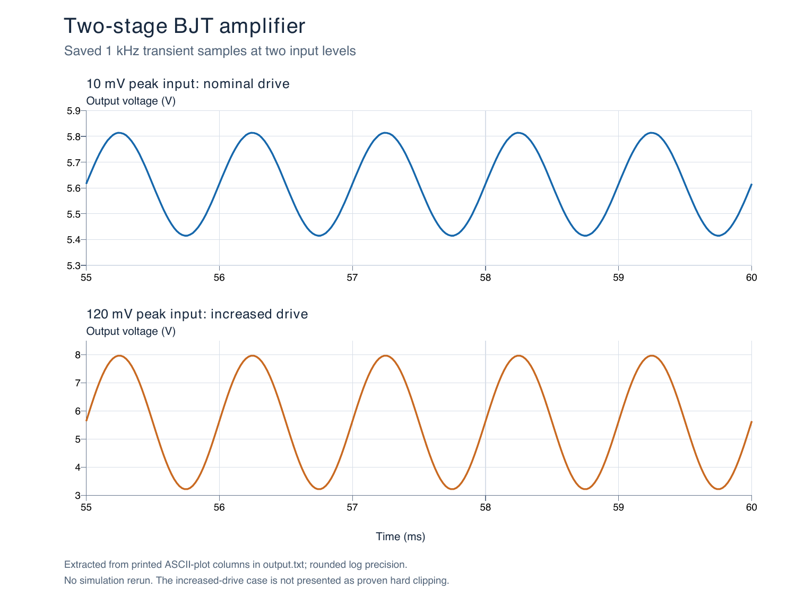

# Two-Stage BJT Amplifier

A 12 V, capacitor-coupled two-stage common-emitter amplifier study. Split emitter resistors control AC gain while maintaining DC bias. Comparisons cover nominal drive, increased drive, and coupling-capacitor value.

## Circuit and analyses

The [netlist](source/bjt-amplifier.cir) contains a 2N3904-class model with its original comments. It performs DC operating-point analysis, 10 mV-peak and 120 mV-peak transients at 1 kHz, and 1 Hz–10 MHz AC sweeps with coupling capacitance of 10 µF and 0.047 µF.

## Saved evidence

The unchanged [ngspice console log](results/logs/output.txt) records completion with `ngspice-41 done`. It contains numeric tables and ASCII plots; no original raw transient-vector file was supplied.

| Observation from the saved log | Result |
| --- | ---: |
| Output DC bias | 5.614626 V |
| Nominal transient Vpp gain | approximately 19.988 V/V |
| AC gain at 1 kHz, 10 µF | 26.01051 dB |
| AC gain at 1 kHz, 0.047 µF | 25.68219 dB |
| Increased-drive output range | 3.207440–7.967709 V |





These plots were newly rendered **from the saved log, without rerunning simulation**. [Nominal AC](results/data/nominal-ac-from-log.csv) and [reduced-coupling AC](results/data/reduced-coupling-ac-from-log.csv) each contain 281 printed samples. [Nominal](results/data/nominal-transient-from-log.csv) and [increased-drive](results/data/increased-drive-transient-from-log.csv) transient CSVs contain 3,001 rounded ASCII-plot samples each, with source line numbers. Vector [AC](results/plots/ac-comparison-from-saved-log.svg) and [transient](results/plots/transient-comparison-from-saved-log.svg) plots are also included.

The source calls the increased-drive case “clipping,” but its Vpp gain remains approximately 19.834 V/V. The supplied evidence does not establish obvious hard clipping. No physical measurements are included.

## Open or run manually

Open the `.cir` file in a text editor. With ngspice installed, run from this project folder:

```sh
cd source
ngspice -b bjt-amplifier.cir > run.log 2>&1
```

Models are embedded. Circuit content is unchanged apart from the filename. A new log stays in `source/`, separate from the supplied evidence under `results/`.

Saved numerical results can also be loaded in ngspice without rerunning the circuit; see the [collection viewing guide](../docs/opening-and-reproduction.md).
