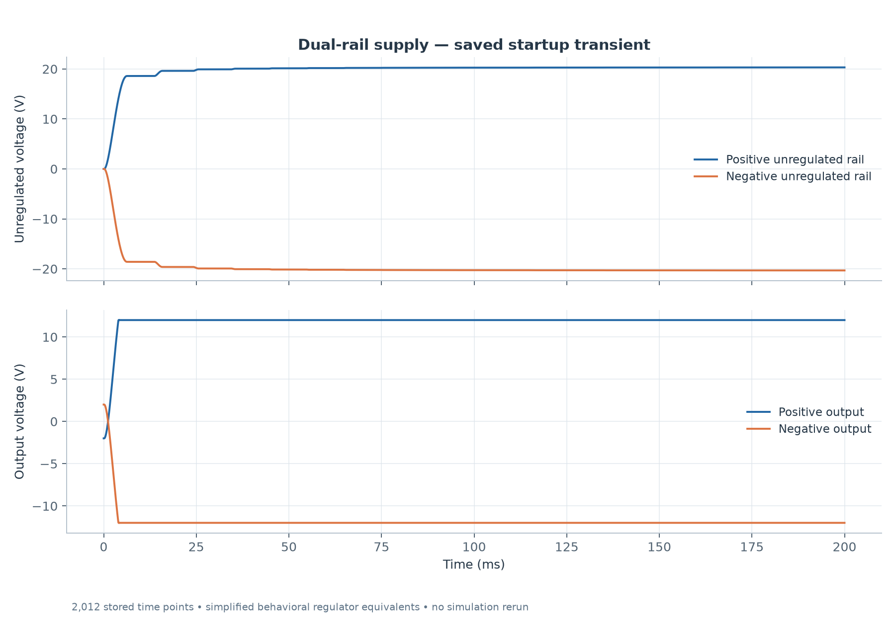
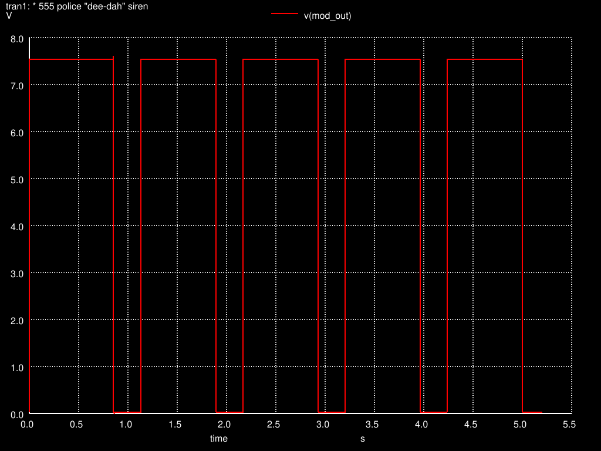
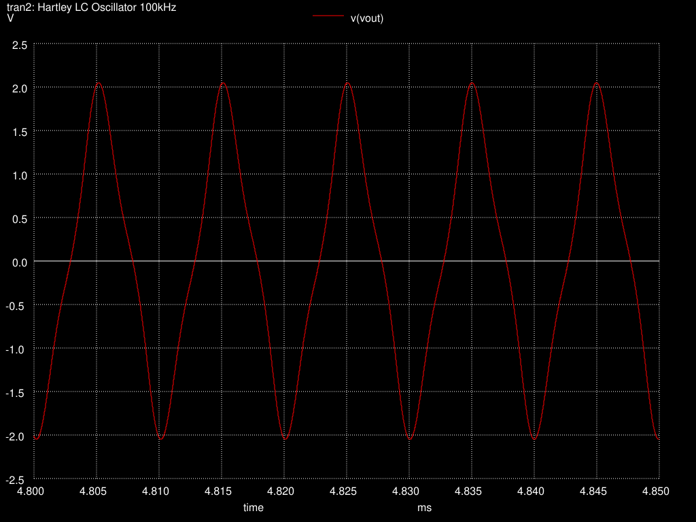

# Simulation Gallery

Selected results from the seven retained studies. Every image is a simulation plot or native CAD export; no hardware photographs or measured signals are implied. Open each study for its full analysis and data.

## Active bandpass filter

[Active bandpass filter study](../qucs-s/active-bandpass-filter/)

Qucs-S + ngspice; fresh corrected amplitude sweep, measured over 80–100 ms.

[Native Qucs plot view](../qucs-s/active-bandpass-filter/docs/images/qucs-plots.png) · [Editable Qucs data display](../qucs-s/active-bandpass-filter/project/active-bandpass-filter.dpl). These are exports of recorded data, not window screenshots.

## Guitar phase-shift / modulation

[Guitar phase-shift / modulation study](../qucs-s/guitar-vibrato/)

Qucs-S + ngspice; fresh wet/dry phase comparison at two points of the modulation cycle.

[Native Qucs plot view](../qucs-s/guitar-vibrato/docs/images/qucs-plots.png) · [Editable Qucs data display](../qucs-s/guitar-vibrato/project/guitar-vibrato.dpl). These are exports of recorded data, not window screenshots.

## Dual ±12 V supply

[Dual ±12 V supply study](../qucs-s/dual-rail-12v-supply/)

Qucs-S + ngspice; plotted from the supplied startup dataset using behavioral regulator models.

[Native Qucs plot view](../qucs-s/dual-rail-12v-supply/docs/images/qucs-plots.png) · [Editable Qucs data display](../qucs-s/dual-rail-12v-supply/project/dual-rail-12v-supply.dpl). These are exports of recorded data, not window screenshots.

## 555 two-tone siren

[555 two-tone siren study](../ngspice/555-two-tone-siren/)

ngspice; supplied slow-modulation waveform. Audio-tone details are linked in the study.

## Hartley LC oscillator

[Hartley LC oscillator study](../ngspice/hartley-oscillator/)

ngspice; supplied steady-state detail, 4.80–4.85 ms. The README distinguishes the target frequency from recorded evidence.

## Two-stage BJT amplifier

[Two-stage BJT amplifier study](../ngspice/bjt-amplifier/)

ngspice; AC curves reconstructed from saved printed values, without a new simulation.

## Linkwitz transform equalizer

[Linkwitz transform equalizer study](../ngspice/linkwitz-transform/)

ngspice; supplied combined equalizer and speaker-equivalent response. This is an electrical model, not acoustic measurement.
