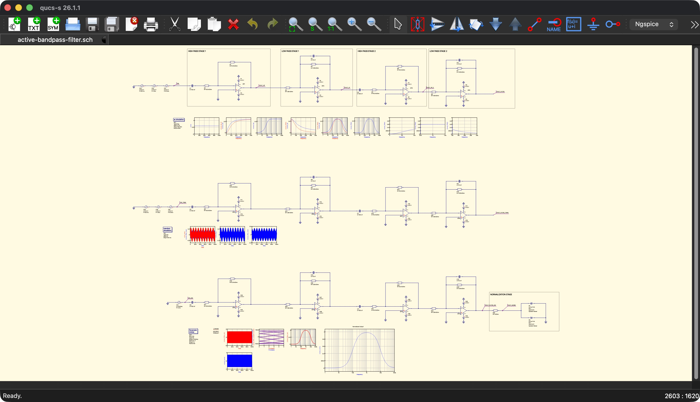
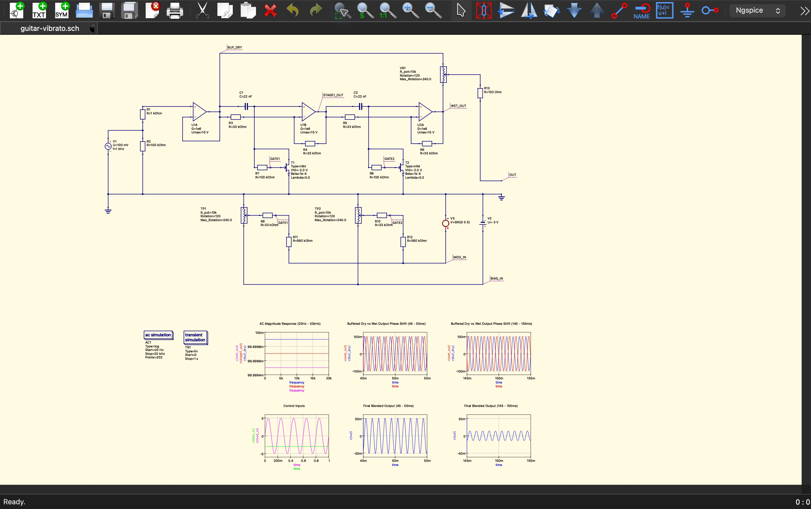
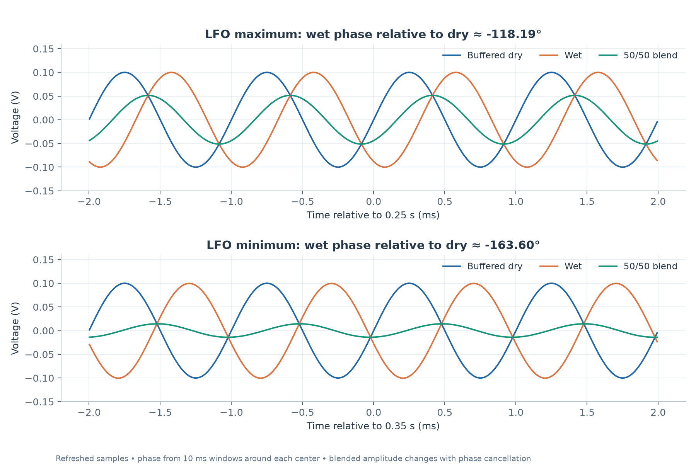
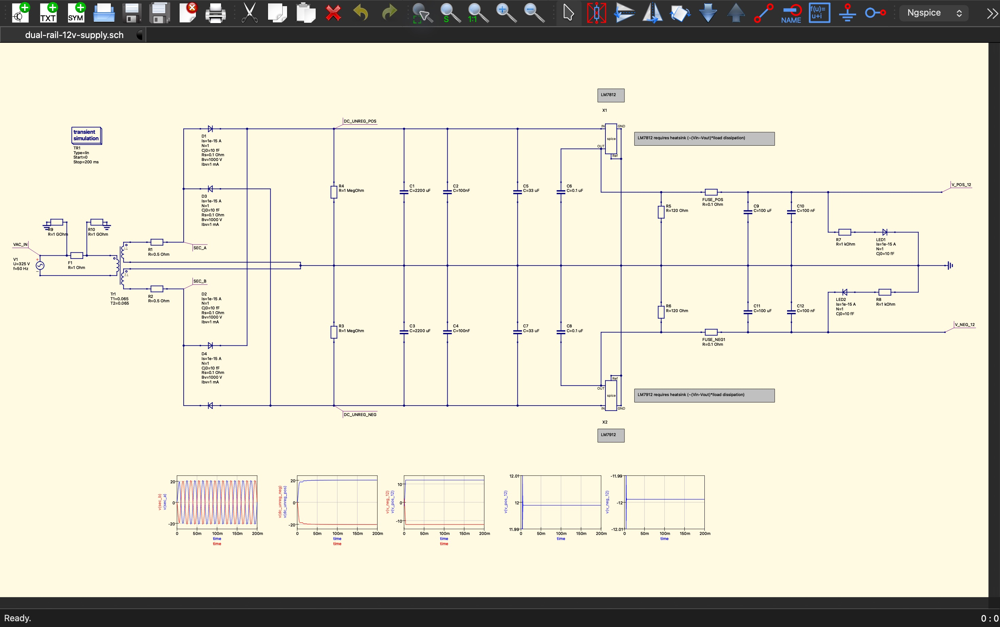

# Simulation Gallery

Selected results from the seven retained studies. Images include simulation plots, native CAD exports and actual Qucs-S schematic window captures; no hardware photographs or measured signals are implied. Open each study for its full analysis and data.

## Active bandpass filter

[Active bandpass filter study](../active-bandpass-filter-qucs-s/)

Qucs-S 26.1.1 schematic overview captured from the application window; some saved plots are visible on the worksheet.

Qucs-S + ngspice; fresh corrected amplitude sweep, measured over 80–100 ms.

[Native Qucs plot view](../active-bandpass-filter-qucs-s/docs/images/qucs-plots.png) · [Editable Qucs data display](../active-bandpass-filter-qucs-s/project/active-bandpass-filter.dpl). These are exports of recorded data, not window screenshots.

## Guitar phase-shift / modulation

[Guitar phase-shift / modulation study](../guitar-vibrato-qucs-s/)

Qucs-S 26.1.1 schematic overview captured from the application window; some saved plots are visible on the worksheet.

Qucs-S + ngspice; fresh wet/dry phase comparison at two points of the modulation cycle.

[Native Qucs plot view](../guitar-vibrato-qucs-s/docs/images/qucs-plots.png) · [Editable Qucs data display](../guitar-vibrato-qucs-s/project/guitar-vibrato.dpl). These are exports of recorded data, not window screenshots.

## Dual ±12 V supply

[Dual ±12 V supply study](../dual-rail-12v-supply-qucs-s/)

Qucs-S 26.1.1 schematic overview captured from the application window; some saved plots are visible on the worksheet.

Qucs-S + ngspice; plotted from the supplied startup dataset using behavioral regulator models.

[Native Qucs plot view](../dual-rail-12v-supply-qucs-s/docs/images/qucs-plots.png) · [Editable Qucs data display](../dual-rail-12v-supply-qucs-s/project/dual-rail-12v-supply.dpl). These are exports of recorded data, not window screenshots.

## 555 two-tone siren

[555 two-tone siren study](../555-two-tone-siren-ngspice/)

ngspice; supplied slow-modulation waveform. Audio-tone details are linked in the study.

## Hartley LC oscillator

[Hartley LC oscillator study](../hartley-oscillator-ngspice/)

ngspice; supplied steady-state detail, 4.80–4.85 ms. The README distinguishes the target frequency from recorded evidence.

## Two-stage BJT amplifier

[Two-stage BJT amplifier study](../bjt-amplifier-ngspice/)

ngspice; AC curves reconstructed from saved printed values, without a new simulation.

## Linkwitz transform equalizer

[Linkwitz transform equalizer study](../linkwitz-transform-ngspice/)

ngspice; supplied combined equalizer and speaker-equivalent response. This is an electrical model, not acoustic measurement.
