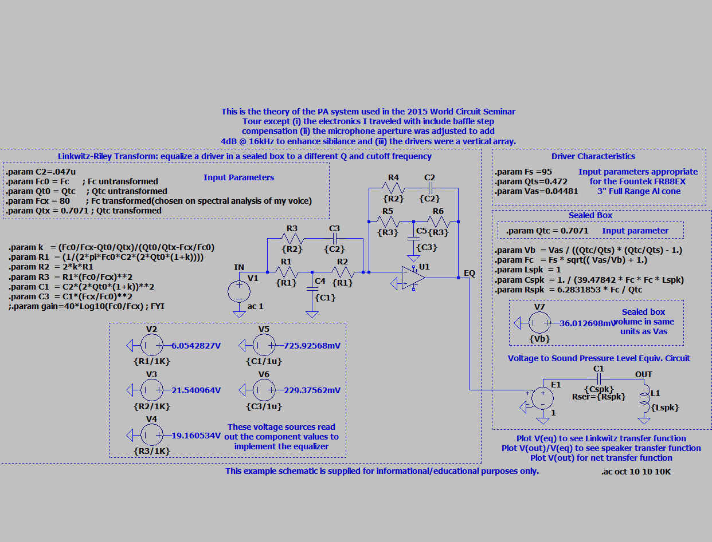
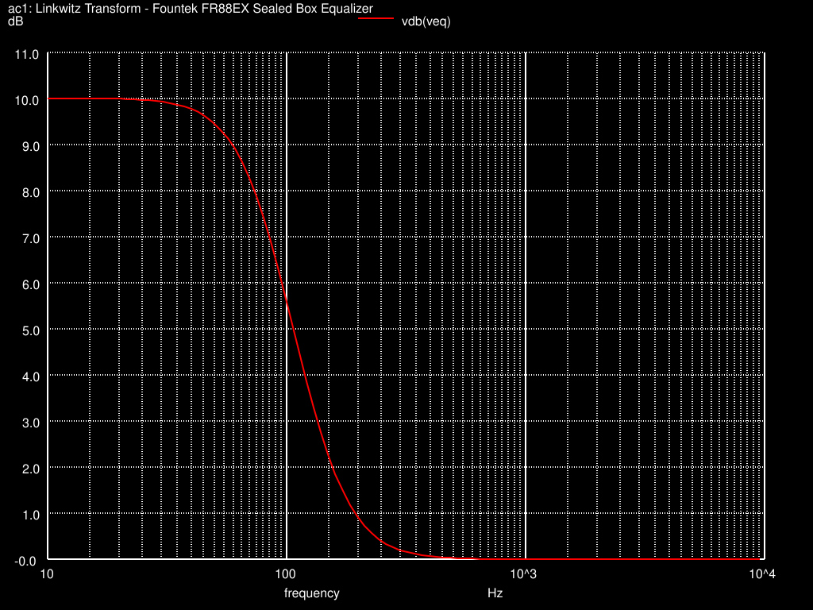
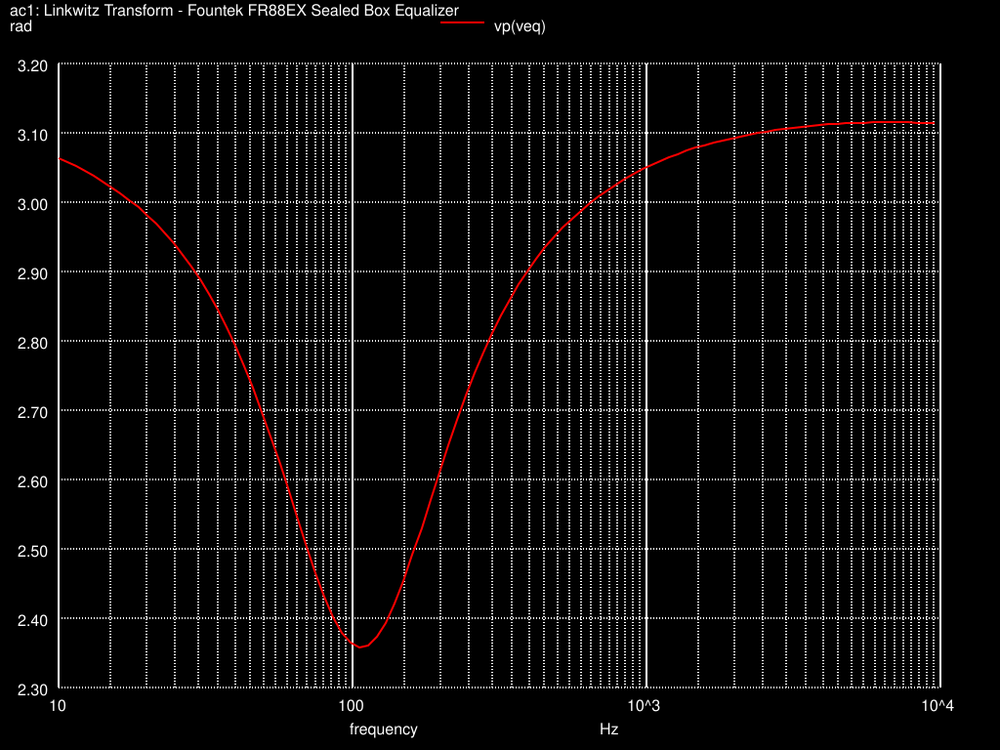
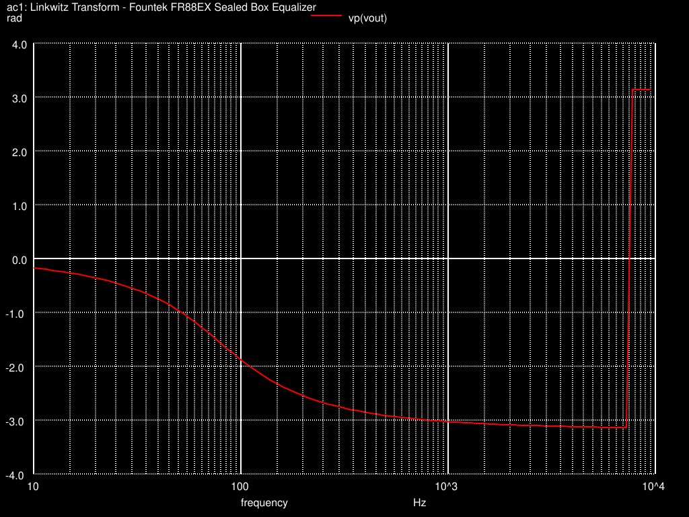
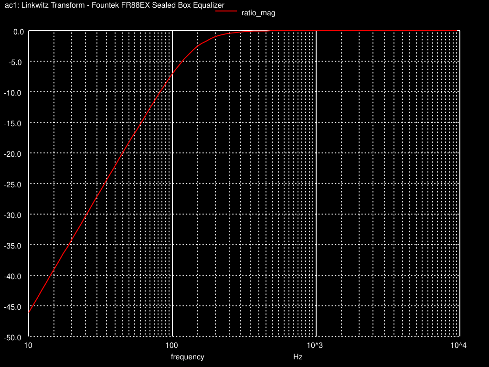
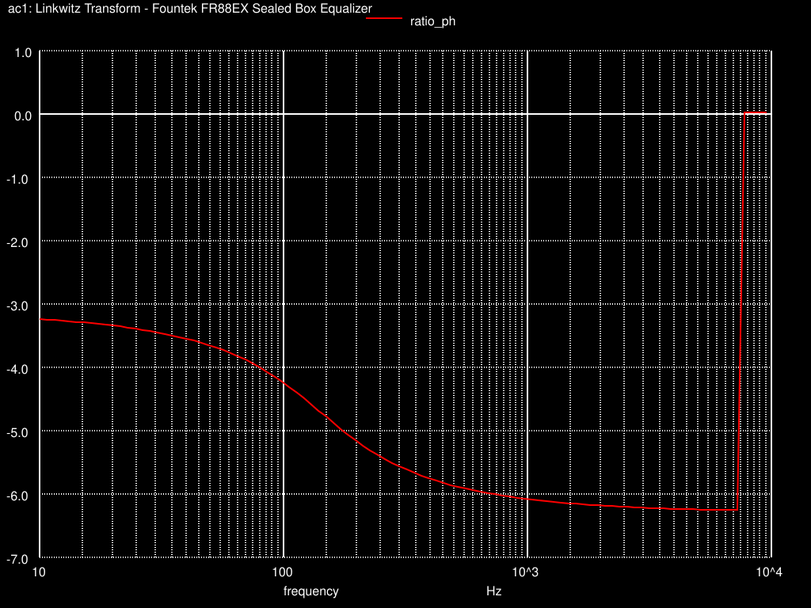
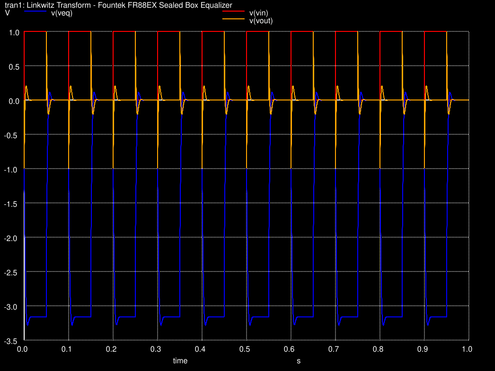

# Simulation Visuals

Existing Linkwitz-transform outputs, preserved without rerunning the circuit. These are simulated electrical responses, not measured acoustic performance. AC plots use a 1 V input over 10 Hz–10 kHz. Phase is in radians.

## Reference circuit

The supplied educational schematic includes its original 2015-seminar annotations. The simulation netlist implements the reference topology with the bundled TL072 model.

## Equalizer stage: EQ

The `veq` node is the equalizer output before the speaker-equivalent model.

**EQ magnitude — `vdb(veq)`, dB relative to the 1 V AC input.**

**EQ phase — `vp(veq)`, radians.**

## Combined equalizer and speaker-equivalent model: OUT

The `vout` node includes both stages. This is the combined modeled response, distinct from the equalizer response above.

**OUT magnitude — `vdb(vout)`, dB relative to the 1 V AC input.**

**OUT phase — `vp(vout)`, radians.**

## Speaker-equivalent model: OUT/EQ

Dividing OUT by EQ removes the equalizer contribution from the AC response.

**OUT/EQ magnitude — `vdb(vout) - vdb(veq)`, dB.** The saved plot's vertical axis omits a unit label; the plotted expression is in dB.

**OUT/EQ phase difference — `vp(vout) - vp(veq)`, radians.** This is the saved phase subtraction; wrapping can cause discontinuities. It is not a newly unwrapped plot.

## Transient response

**Input, EQ and OUT voltages — 0–1 V, 10 Hz square-wave stimulus over one second.** The three legend entries are `v(vin)`, `v(veq)` and `v(vout)`; the vertical axis is volts.

**Diagnostic only: [instantaneous OUT/EQ ratio](../linkwitz-transform/linkwitz_tran_ratio.svg).** This dimensionless time-domain division is sensitive to EQ values near zero and produces large spikes. It is not the AC transfer function and is not a useful showcase of gain or stability. The plot is retained for traceability.

## Other studies

The active-bandpass and guitar-vibrato folders contain schematics and saved Qucs-S datasets, but no standalone exported plot images. Their plots should be regenerated and reviewed in Qucs-S before adding them to this gallery; the vibrato connectivity issue is documented in its study notes.
