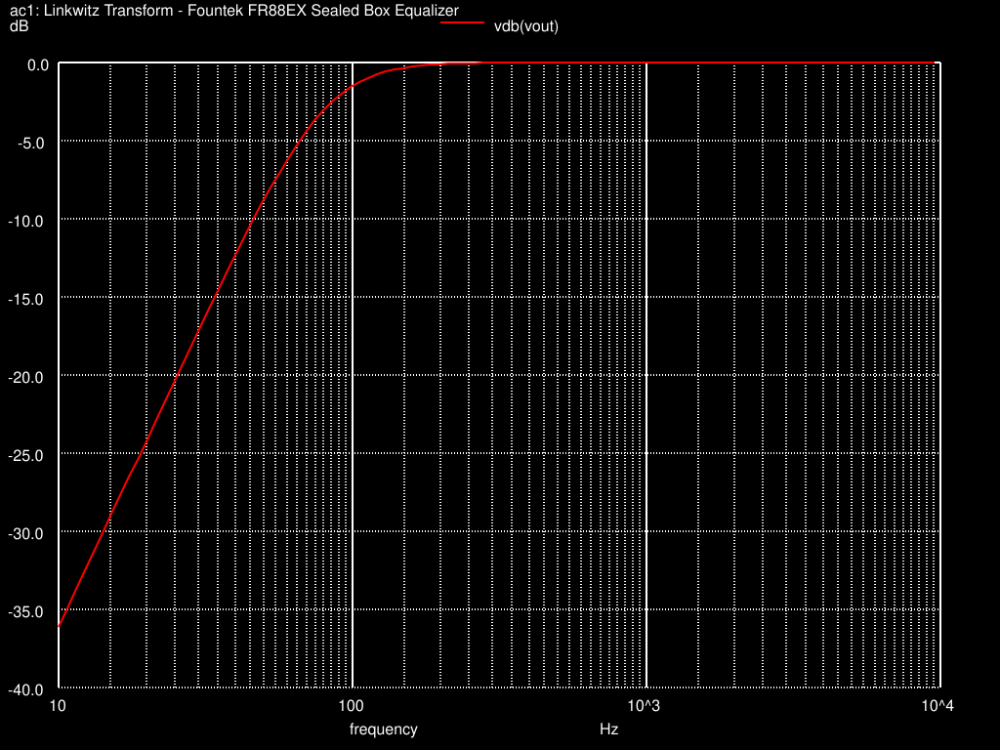

# Linkwitz Transform Equalizer

A parameterized TL072 equalizer feeding a sealed-box speaker equivalent. The study separates the equalizer response from the combined output and the speaker-equivalent response.

## Circuit and analyses

The [netlist](source/linkwitz-transform.cir) uses ±15 V supplies and the bundled [TL072 model](source/models/Tl072.mod). The target transformed cutoff is 80 Hz. Analyses request a 10 Hz–10 kHz AC sweep with a 1 V input and a one-second transient driven by a 0–1 V, 10 Hz square wave.

The [reference schematic](references/reference-schematic.png) is the supplied educational example associated with a 2015 seminar. Its annotations and the model header are retained. That reference topology and model are distinct from the manual simulation work represented here.

## Saved evidence

Three [AC datasets](results/data/) contain 100 points each, from 10 to 9,554.25783 Hz. At 10 Hz, the saved EQ magnitude is approximately +10.0058 dB and combined OUT is −36.1248 dB. Four transient datasets contain 10,746 points each over 0–1 s. All numeric data and eight SVG plots are preserved unchanged.



| Response | Magnitude | Phase |
| --- | --- | --- |
| Equalizer only, EQ | [dB](results/plots/linkwitz_ac_eq_mag.svg) | [radians](results/plots/linkwitz_ac_eq_phase.svg) |
| Equalizer plus speaker equivalent, OUT | [dB](results/plots/linkwitz_ac_out_mag.svg) | [radians](results/plots/linkwitz_ac_out_phase.svg) |
| Speaker equivalent, OUT/EQ | [dB](results/plots/linkwitz_ac_ratio_mag.svg) | [radians](results/plots/linkwitz_ac_ratio_phase.svg) |

[Transient voltages](results/plots/linkwitz_tran_waveforms.svg) show input, EQ and OUT. The [instantaneous OUT/EQ ratio](results/plots/linkwitz_tran_ratio.svg) is diagnostic: division near zero produces spikes of approximately −3644 to +948. It is not an AC gain measurement. Phase differences may wrap, and the ratio plots omit unit labels. These electrical equivalents are not measured acoustic responses. No simulation was rerun during packaging.

## Open or run manually

Open the `.cir` file in a text editor. With ngspice installed, run from this project folder:

```sh
cd source
ngspice -b linkwitz-transform.cir > run.log 2>&1
```

Keep `models/` beside the netlist. New fixed-name outputs stay in `source/`; supplied evidence remains under `results/`. Only the relative model include was changed. Use this command rather than the historical filename in the source comment.

Saved numerical results can also be loaded in ngspice without rerunning the circuit; see the [collection viewing guide](../../docs/opening-and-reproduction.md).
