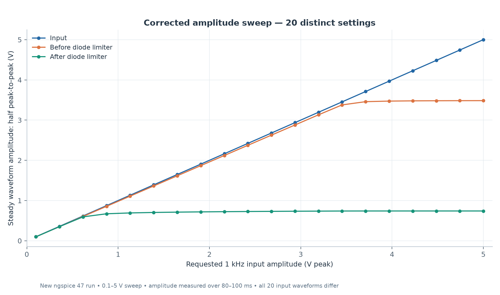
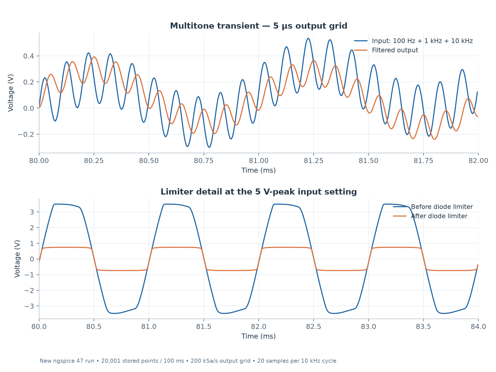
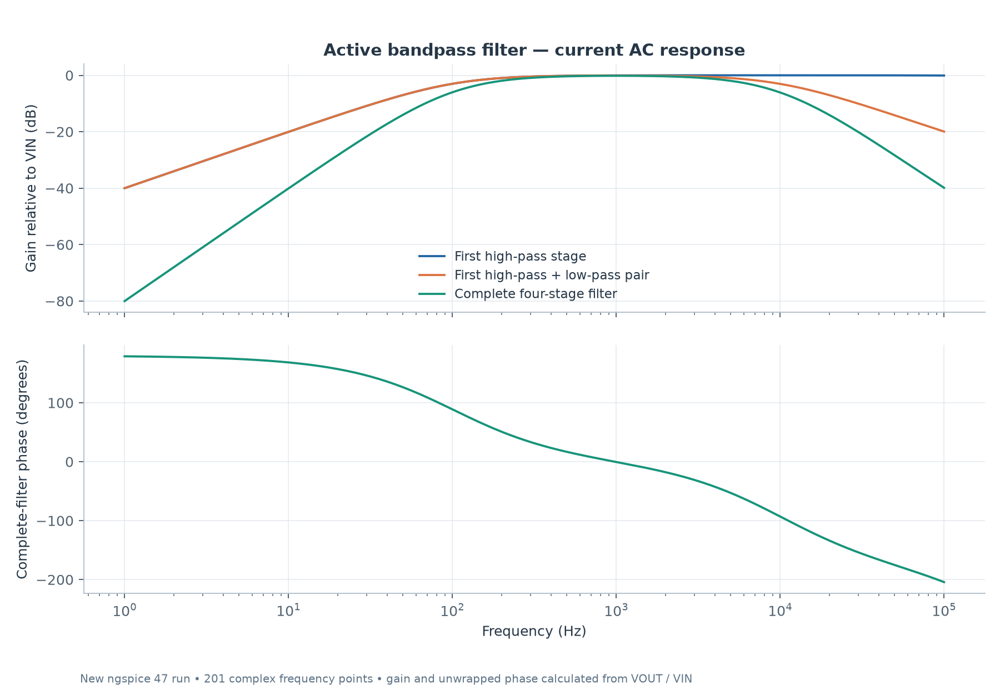

# Active Bandpass Filter

An LM324 study with cascaded high-pass and low-pass stages, multitone excitation, and a diode output limiter. The current revision uses a working input-amplitude sweep and a finer transient output grid.

Open [the schematic](project/active-bandpass-filter.sch) in **Qucs-S with the ngspice backend selected**. Its [current dataset](project/active-bandpass-filter.dat.ngspice) accompanies the existing diagrams. Results were generated with **Qucs-S 26.1.1** netlist export and **ngspice 47**.

## Amplitude sweep

`VinAmp` sweeps the 1 kHz sine input from 0.1 to 5 V across 20 settings. All 20 runs completed, with distinct observed input amplitudes from **0.09999915 to 4.99995835 V peak**. The transient stores 20,001 points over 100 ms: **5 µs spacing**, or 20 samples per 10 kHz cycle.

Amplitude is half the measured peak-to-peak range over 80–100 ms. At the 5 V setting, the filter output spans **6.96742 V peak-to-peak** and the limited output spans **1.48037 V peak-to-peak**. The larger settings show nonlinear behavior; these curves are not ideal-gain specifications. [All 20 measurements](results/data/sweep-verification.csv) · [Vector plot](results/plots/corrected-amplitude-sweep.svg).

## Transient and frequency response

The multitone source combines 0.2 V-peak signals at 100 Hz, 1 kHz and 10 kHz. The lower panel shows the limiter at the largest input setting. [Vector plot](results/plots/corrected-transient-detail.svg).

The AC analysis contains 201 points from 1 Hz to 100 kHz. The largest sampled complete-filter gain is **−0.174 dB at 1 kHz**. Gain and unwrapped phase use the complex output/input ratio. [Vector plot](results/plots/corrected-ac-response.svg).

## Reproduction

The schematic uses Qucs-S's `SpiceOpamp / LM324` library. Run it in the GUI with ngspice selected, or copy the [exported netlist](project/generated-netlist.cir) to a scratch directory and run `ngspice -b generated-netlist.cir`; its amplifier model is embedded.

The full sweep completed in about 23 seconds. The Qucs dataset was formatted from native raw outputs and verified value-for-value. [Metrics and provenance](results/metrics.json) and the [simulation log](results/logs/ngspice47.log) document the run. Only the sweep setup, saved sampling and matching diagram selectors were corrected; circuit topology and component values were retained. These are simulations, not physical measurements.

## Native Qucs views

[Open the arranged plot display](project/active-bandpass-filter.dpl) or inspect the [native plot export](docs/images/qucs-plots.png). These load the matching recorded dataset without a simulation run. The curated figures above add units and interpretation; the native view retains the original diagram expressions and axes.
