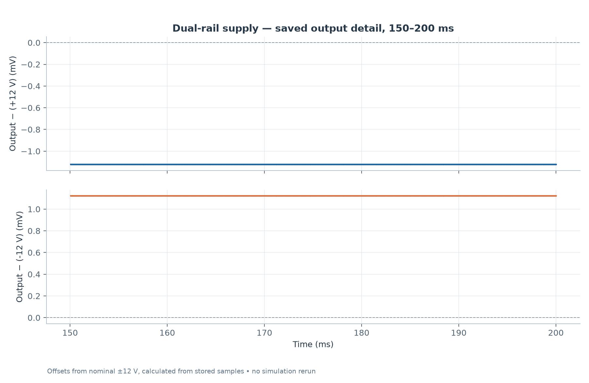

# Dual ±12 V Supply Study

A transformer, rectifier and reservoir/filter supply study with positive and negative 12 V **behavioral regulator equivalents**. It explores startup and stored output-rail behavior; it is not a manufacturer-accurate regulator or hardware-validation model.

Open [the schematic](project/dual-rail-12v-supply.sch) in the **Qucs-S GUI with its ngspice backend**. The source files record Qucs 25.2.0. The [saved dataset](project/dual-rail-12v-supply.dat.ngspice) contains 2,012 time points over 200 ms, and five diagram panels are embedded in the schematic. Original base/final schematics differ only in view/output names; their datasets are byte-identical.

## Saved results

The startup chart retains the complete saved output behavior, including the simplified models' initial excursions. [Vector chart](results/plots/startup-transient.svg).

The detail chart subtracts the nominal +12 V or −12 V from each stored output sample and displays the difference in millivolts. It does not introduce a new simulation or measurement. [Vector chart](results/plots/output-detail.svg). [Metrics and provenance](results/metrics.json) include full-record and 150–200 ms statistics.

## Models and interpretation

Keep [the supplied models](project/models/) with the project. `lm7812_eq.cir` and `lm7912_eq.cir` use conditional behavioral voltage sources with an approximate 2 V dropout rule. These simplified equivalents do not establish real-device load regulation, current limiting, dissipation or stability.

The saved netlist now uses relative paths to bundled Qucs-S transformer and math-helper files. Its original numerical dataset is unchanged.

**No simulation was rerun.** Plots and statistics come only from supplied saved samples. No physical measurements are included.

## Native Qucs views

[Open the arranged plot display](project/dual-rail-12v-supply.dpl) or inspect the [native plot export](docs/images/qucs-plots.png). These load the matching recorded dataset without a simulation run. The curated figures above add units and interpretation; the native view retains the original diagram expressions and axes.

[Native schematic and saved plots](docs/images/qucs-saved-view.svg) are also included.
