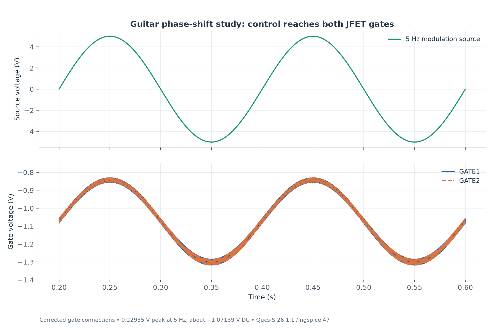

# Guitar Phase-Shift / Modulation Study

A simulation study of two JFET phase-shift stages, behavioral op amps, and a dry/wet blend. The circuit uses a 100 mV, 1 kHz signal, a 5 Hz modulation source, and a −3 V bias source. Fresh simulation verifies that modulation reaches both JFET gates and changes the wet signal’s phase.

Open [the schematic](project/guitar-vibrato.sch) in **Qucs-S with ngspice**. The matching [native dataset](project/guitar-vibrato.dat.ngspice) was regenerated with **Qucs-S 26.1.1 / ngspice 47**: 202 AC points and 100,008 transient points over one second. No simulator warnings were recorded.

Both gates track the 5 Hz source with approximately **0.229 V peak modulation** around **−1.071 V DC**. [Vector plot](results/plots/gate-control.svg).

The wet signal’s 1 kHz fundamental remains approximately **100 mV peak**. Its phase relative to the dry signal changes from approximately **−118.19°** near modulation maximum to **−163.60°** near minimum. The 50/50 blend shows the resulting phase cancellation. [Vector plot](results/plots/phase-and-blend.svg).

Control-node connections were corrected before regenerating these results; component values and stimuli were retained. [Brief change note](results/change-notes.txt), [metrics and dataset provenance](results/metrics.json), [dataset checks](results/dataset-validation.json), and [simulator log](results/logs/ngspice.log) accompany the project.

The original circuit study is the author’s manual design. This is a CAD/simulation project with idealized op amps; no fabricated hardware or bench measurements are claimed.

## Native Qucs views

[Open the arranged plot display](project/guitar-vibrato.dpl) or inspect the [native plot export](docs/images/qucs-plots.png). These load the matching recorded dataset without a simulation run. The curated figures above add units and interpretation; the native view retains the original diagram expressions and axes.
